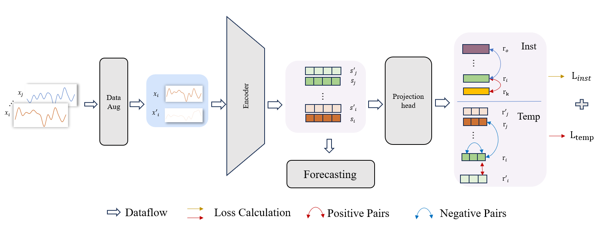

# TimesFNP: Contrastive Learning for Financial Domain with Noise-Resilient Prediction

**Authors:** Shaofei Shen, Qing Li, Yan Chen, Rui Cheng, Yu Zheng (Southwestern University of Finance and Economics)
**Venue:** 2025 11th International Conference on Computing and Artificial Intelligence (ICCAI 2025), pp. 697–704
**Paper:** https://doi.org/10.1109/ICCAI66501.2025.00111
**Code owner:** Shaofei Shen (@shensf0522)

## Overview

TimesFNP improves long-horizon financial time-series forecasting under heavy noise by combining contrastive representation learning with a Transformer forecaster. A noise-based augmentation module builds positive views (frequency-adaptive sampling that keeps the dominant spectral components) and negative views (noise drawn from a mixture of Gaussian / uniform / lognormal distributions). Two InfoNCE objectives shape the representation: a temporal-wise loss that separates trend from noise within each series, and an instance-wise loss that pulls together companies from the same industry while pushing apart different industries (momentum-spillover intuition). A patch-based Transformer encoder–decoder then produces the multi-step forecast, with macroeconomic covariates fused into the decoder. The implementation in this folder is the code for the ICCAI 2025 paper, covering data preparation, training and evaluation.



## Code map

| File | Content |
|---|---|
| `src/train.py` | Training entry point (command-line interface); joint loss = forecast MSE + λ1·instance InfoNCE + λ2·temporal InfoNCE; early stopping on validation MSE. |
| `src/evaluate.py` | Test evaluation (MSE / MAE, plus raw-scale metrics) and result aggregation. |
| `src/model.py` | TimesFNP model: patch embedding + positional encoding → Transformer encoder; learnable query tokens + covariate projection → cross-attention decoder; contrastive projection heads. `--model base` is the same architecture without contrastive learning. |
| `src/losses.py` | Temporal-wise InfoNCE (Eq. 2) and instance-wise InfoNCE (Eq. 3), cosine similarity, temperature τ. |
| `src/augment.py` | Frequency-adaptive sampling (FFT dominant-component reconstruction) and mixed-distribution noise injection. |
| `src/dataset_gkx.py` | Stock-panel pipeline: window sampling, industry-stratified batches (same-industry positives), target transforms (`ret`, `rank`, `path_winz`, `path_minmax`, `path_z`), scaling options. |
| `src/dataset_ett.py` | ETTh1 pipeline (standard 12/4/4-month split, seq_len 96, pred_len 96); temporal-wise loss only (no industry labels). |
| `data/prepare_gkx.py` | Builds the monthly panel from the GKX datashare: excess returns (mom1m − risk-free), activity filtering, macro-covariate standardization → `data/processed/gkx_panel.npz`. |
| `data/extract_macro.py` | Extracts the 8 Welch–Goyal macro variables and the monthly risk-free rate from the official spreadsheet. |
| `data/fast_download.py` | Resumable multi-thread downloader for the 1.5 GB datashare archive (optional helper for slow networks). |
| `run_experiments.sh` | Runs the main experiment pair (base vs. TimesFNP) sequentially. |
| `figures/framework.png` | Model framework figure (Fig. 1 of the paper). |

## Environment

The code was developed and tested with:

- Python 3.10
- PyTorch 2.5.1, CUDA 12.1 (one NVIDIA RTX 4080; CPU-only wheels also work, training is just slower)

Install the dependencies from this folder:

```bash
pip install -r requirements.txt
# CUDA 12.x build of the pinned PyTorch version (optional, if the default wheel is CPU-only)
pip install torch==2.5.1 --index-url https://download.pytorch.org/whl/cu121
```

## Data

All datasets are public. Download them into `data/raw/` (excluded from version control, see `.gitignore`).

### a. GKX datashare — main dataset (CRSP-sourced monthly stock panel)

- **Name:** Empirical Asset Pricing via Machine Learning public dataset (Gu, Kelly & Xiu, 2020, RFS; sourced from CRSP)
- **Download link:** https://dachxiu.chicagobooth.edu/download/datashare.zip (~1.5 GB; `datashare.csv` ≈ 3.8 GB after unzip)
- **Access code:** not required
- **Access conditions:** none
- **Placement:** `data/raw/gkx_datashare.zip` → unzip → `data/raw/datashare.csv` (on slow networks `python data/fast_download.py` fetches it automatically to this path)
- **Scope used:** 1957-03 – 2016-12, NYSE/AMEX/NASDAQ, ~30,000 stocks.
- **Field mapping:** the file has no `RET` column; `mom1m` (1-month momentum) is by the Green–Hand–Zhang definition the monthly CRSP total return, and is used as the monthly return; `sic2` (2-digit SIC) provides the industry labels for the instance-wise contrastive loss.
- **Split:** train 1957–1989 / validation 1990–1999 / test 2000–2016 (chronological, by forecast-target month; input windows may look back, no leakage).
- **Preprocessing:** `python data/prepare_gkx.py`

### b. Welch–Goyal macro predictors — 8 macro covariates + risk-free rate

- **Name:** Welch & Goyal (2008) PredictorData (public, Amit Goyal's homepage)
- **Download link:** https://sites.google.com/view/agoyal145 (export the **Monthly** sheet of the linked spreadsheet as xlsx)
- **Access code:** not required
- **Access conditions:** none
- **Placement:** `data/raw/goyal_1qwpl2R_DNujpU5YUkk8lacP1tTeMb9iJ.xlsx` (the file name may change between versions; keep it in sync with `SRC` in `data/extract_macro.py`)
- **Preprocessing:** `python data/extract_macro.py` → `data/raw/macro_gw.csv` (dp, ep, bm, ntis, tbl, tms, dfy, svar) and `data/raw/riskfree.csv`

### c. ETTh1 — auxiliary experiment (optional)

- **Name:** ETTh1 (Electricity Transformer Temperature, hourly, 7 channels)
- **Download link:** https://github.com/zhouhaoyi/ETDataset (ETT-small/ETTh1.csv)
- **Access code:** not required
- **Access conditions:** none
- **Placement:** `data/raw/ETTh1.csv`
- **Split:** standard protocol, train/val/test = 12/4/4 months; seq_len 96, pred_len 96

## Training

Run from this folder (the parent of `src/` and `data/`):

```bash
# 0. Data preparation (after placing the raw files as above)
python data/extract_macro.py
python data/prepare_gkx.py

# 1. Main experiment: TimesFNP (+CL) vs. base (no CL), main configuration
python src/train.py --dataset gkx --model base     --horizon 1 --target path_winz --lookback 120 --epochs 40
python src/train.py --dataset gkx --model timesfnp --horizon 1 --target path_winz --lookback 120 --epochs 40 --lambda1 0.1 --lambda2 0.1

# 2. Other horizons / target transforms (examples)
python src/train.py --dataset gkx --model timesfnp --horizon 3 --target path_winz --lookback 60 --epochs 40
python src/train.py --dataset gkx --model timesfnp --horizon 1 --scale z --lookback 60

# 3. ETT auxiliary experiment (temporal-wise loss only)
python src/train.py --dataset ett --model base     --horizon 96 --batch 32 --lambda1 0 --lambda2 0
python src/train.py --dataset ett --model timesfnp --horizon 96 --batch 32 --lambda1 0 --lambda2 0.1

# One-shot main experiment pair
bash run_experiments.sh
```

Useful options (defaults in parentheses):

| Option | Meaning |
|---|---|
| `--model` | `timesfnp` (with contrastive learning) or `base` (same architecture, no CL). |
| `--dataset (gkx)` | `gkx` (stock panel) or `ett`. |
| `--horizon` | Forecast steps: {1, 3, 6, 12} for gkx; 96 for ett. |
| `--target (ret)` | gkx target transform: `ret`, `rank`, `path_winz`, `path_minmax`, `path_z`. |
| `--scale (winz)` | Scaling for `--target ret`: `raw`, `pct`, `z`, `winz`. |
| `--lookback (36)` | Input window length (120 in the main configuration). |
| `--patch (3)` | Patch length for the encoder embedding. |
| `--dmodel (64)` | Latent dimension of the Transformer. |
| `--lambda1/--lambda2 (1.0)` | Weights of the instance-wise / temporal-wise contrastive losses (0.1 in the main configuration). |
| `--tau (0.1)` | InfoNCE temperature. |
| `--keep-ratio (0.3)` | Energy ratio kept by frequency-adaptive sampling. |
| `--noise-scale (1.0)` | Scale of the injected mixture noise. |
| `--epochs (30)` / `--patience (5)` | Max epochs / early-stopping patience on validation MSE. |
| `--batch (64)` / `--lr (1e-4)` | Batch size / Adam learning rate. |
| `--device (cuda)` / `--seed (42)` | Compute device / random seed. |

Training writes logs to `results/logs/` and the best checkpoint (selected by validation MSE) to `checkpoints/`. Both directories are created automatically.

## Evaluation

```bash
# Single checkpoint (tag encodes the configuration)
python src/evaluate.py --tag gkx_timesfnp_l01-01_L120p3D64_path_winz_H1

# Aggregate all logged runs into results/results.md and results/results.csv
python src/evaluate.py --aggregate
```

## Checkpoints

Trained checkpoints (about 59 MB in total) are not stored in this repository. They can be regenerated with the training commands above; `train.py` saves the best model under `checkpoints/` with the configuration encoded in the file name, e.g. `gkx_timesfnp_l01-01_L120p3D64_path_winz_H1.pt`.

## Notes on this submission

- A single training run takes about 3–15 minutes on an RTX 4080 (early stopping typically triggers within 10 epochs).
- On ETT, industry labels do not exist, so the instance-wise loss is disabled (`--lambda1 0`) and only the temporal-wise loss is applied.
- No API keys, credentials, personal paths or private data are included. Raw data, checkpoints and training logs are intentionally not part of this submission (see `.gitignore`).

## Citation

```bibtex
@inproceedings{shen2025timesfnp,
  title     = {TimesFNP: Contrastive Learning for Financial Domain with Noise-Resilient Prediction},
  author    = {Shen, Shaofei and Li, Qing and Chen, Yan and Cheng, Rui and Zheng, Yu},
  booktitle = {2025 11th International Conference on Computing and Artificial Intelligence (ICCAI)},
  pages     = {697--704},
  year      = {2025},
  doi       = {10.1109/ICCAI66501.2025.00111}
}
```
