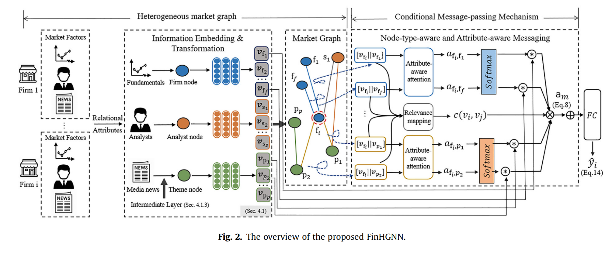

# FinHGNN: A Conditional Heterogeneous Graph Learning to Address Relational Attributes for Stock Predictions

**Authors:** Jinghua Tan, Qing Li, Jun Wang, and Junxiao Chen  
**Journal:** *Information Sciences*, 618 (2022), 317–335  
**DOI:** [10.1016/j.ins.2022.11.013](https://doi.org/10.1016/j.ins.2022.11.013)

## Overview

FinHGNN is a conditional heterogeneous graph neural network for stock prediction. It models firm, analyst, and news-theme nodes in a heterogeneous market graph to capture momentum, analyst, and media spillovers. Its conditional message-passing mechanism accounts for both node types and node attributes.

## Included files

- `main.py` — model training and evaluation procedure.
- `models/Model.py` — overall FinHGNN model architecture.
- `models/Layers.py` — graph-learning layers and conditional message-passing components.
- `data/sample/Feature_normalized_sample10.pkl` — sample normalized stock features.
- `data/sample/adj_analytic_sa_total_sample10.pkl` — sample stock–analyst adjacency data.
- `data/sample/y_pickle_sample10.pkl` — sample stock-trend labels.

## Data note

The included pickle files are small illustrative samples from the original code package. They are not the complete S&P 500 or NASDAQ datasets and do not contain all inputs referenced by the original training script (such as the full topic, relation, and analyst data).

This folder is a lightweight archive of selected research code and sample data. It is provided for reference and is not intended to guarantee a complete reproduction of the paper or compatibility with current software environments.
